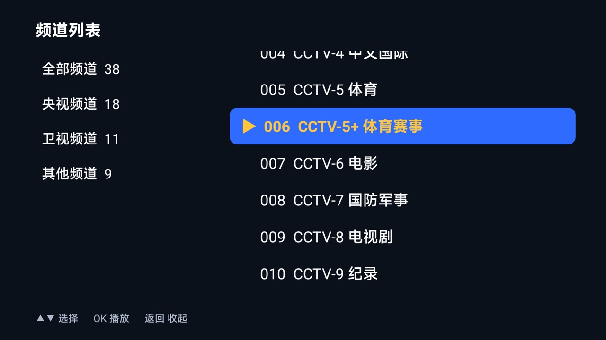

# 极简电视 · TVLive

> 一个只有三个按键的电视直播 App：**打开就是台，上下键换台，OK 键挑台**。
> 给不太会用智能电视的老人用。37 KB，零第三方依赖，Android 5.0+，遥控器操作。

[](https://github.com/zhangcongshuai/TVLive/releases)
[](LICENSE)
[-3DDC84)](https://developer.android.com)
[](https://github.com/zhangcongshuai/TVLive/releases)

<p align="center">
  
  
</p>

## 为什么做这个

家里老人看电视，卡住的从来不是"没有台"，而是**操作路径太长**：开机广告 → 找到应用 → 记住菜单位置 →
选分类 → 选频道 → 万一没画面，还得琢磨怎么换源。每一步都要人教，教完下次又忘。

这个 App 把这一串动作压缩成一个规则：**打开就在播，上下就是换台**。
其他一概不做——没有切换源界面、没有小窗、没有 EPG、没有设置页。想换台就按 OK 打开列表，
列表里当前台有黄色 `▶` 标记，还能用数字键直接跳到台号。

## 特性

| | |
|---|---|
| **开机即播** | 启动直接续播上次看的台，记住位置 |
| **▲ / ▼ 换台** | 到头循环；已经在这个台上时按上下键不会重复重连黑屏 |
| **OK 弹列表** | 左侧分类（获得焦点即预览该分类），右侧频道，按 OK 播 |
| **数字键跳台** | 按 `0` `5` → 跳到 005 台，输入后 1.8 秒自动生效 |
| **一个台多个源** | 播放失败自动换下一个源，信息条显示"换个源试试… 2/3" |
| **失败不黑屏** | 播不起来时信息条常驻并说明原因，不会让老人对着黑屏猜 |
| **看门狗** | 15 秒没进 `onPrepared` 就当失败，先换源，全换完再重试 2 次 |
| **可换源** | 覆盖一个 m3u 文件即可，不用重装 APK |
| **零依赖** | 37 KB，不用 ExoPlayer / AndroidX / Gradle |

字号按老人视距调过：台名 30sp、台号 52sp、列表 24sp。

## 下载安装

到 [Releases](https://github.com/zhangcongshuai/TVLive/releases) 下载 `TVLive-1.0.apk`，然后任选一种装法：

```bash
# 电视开启了 ADB 调试（同一局域网）
adb connect 192.168.1.x:5555
adb install -r TVLive-1.0.apk
```

或者把 APK 拷到 U 盘，插电视上用自带的文件管理器安装。App 会同时出现在普通应用列表和
Android TV 的 Leanback 启动器里（带 320×180 的 banner 图）。

## 按键

| 按键 | 行为 |
|---|---|
| `▲` / `▼` | 上一个台 / 下一个台（循环） |
| `OK`（确定） | 弹出频道列表：左右换分类，上下选台，再按 OK 播放 |
| 数字键 | 直接输入台号跳转，如按 `1` `2` → 012 台 |
| `返回` | 弹出 / 收起频道列表（不会误退出 App） |

退出 App 用遥控器的 Home 键——**特意没让返回键能退出**，避免老人误触。

## 内置频道

当前内置 **38 个台**，全部是**在这台电视上一台一台播出来**验证过的（不是只测 HTTP 200）：

| 分类 | 数量 | 内容 |
|---|---|---|
| 央视频道 | 18 | CCTV-1/2/3/4/5/5+/6/7/8/9/10/11/12/13/14/15/16/17 全套 |
| 卫视频道 | 11 | 东方、浙江、湖南、黑龙江、河北、东南、大湾区、广西、延边、内蒙古、人间 |
| 其他频道 | 9 | CGTN 六种语言、CHC 电影、央视台球、浙江钱江 |

源的原始素材来自 [ngo5/IPTV](https://github.com/ngo5/IPTV) 等公开列表，但**能用哪些完全取决于你家的宽带**
（移动/电信/联通的 CDN 各不相同，IPv4 / IPv6 可达性也不同）。所以仓库里同时放了：

- `assets/playlist.m3u` —— 内置的 38 台（我这边实测可播）
- `playlist.full.m3u` —— 当初 65 台的完整候选，另外 27 台在我这条线路上已失效，你那边可能是好的

**换成你自己的源，大概率比用我这份更稳。**

## 换源（不用重装）

App 启动时按这个顺序找列表：

1. `/sdcard/Android/data/com.mini.tvlive/files/playlist.m3u` ← 优先
2. APK 内置的 `assets/playlist.m3u`

```bash
adb push my.m3u /sdcard/Android/data/com.mini.tvlive/files/playlist.m3u
adb shell am force-stop com.mini.tvlive    # 重启 App 生效
```

格式是标准 M3U，`group-title` 是分类名，逗号后是频道名，下一行是地址：

```m3u
#EXTM3U

#EXTINF:-1 group-title="央视频道",CCTV-1 综合
http://example.com/cctv1-a.m3u8
#EXTINF:-1 group-title="央视频道",CCTV-1 综合
http://example.com/cctv1-b.m3u8
```

**同名同分组的多条记录 = 同一个台的多个备用源**，按顺序试。台号按频道首次出现的顺序自动编号 001、002…

## 维护源：两个调试开关

公共源会失效。仓库里自带两个只在放了标记文件时才启用的调试功能，用来判断"到底哪些台真能出画"。

### 1. 源自检 `dotest.marker`

后台逐条探测所有地址，结果写到 `probe_result.txt`，每行 `状态码:类型|分组|频道名|地址`：

```bash
adb shell "echo x > /sdcard/Android/data/com.mini.tvlive/files/dotest.marker"
adb shell am force-stop com.mini.tvlive
adb shell am start -n com.mini.tvlive/.MainActivity
# 等它跑完（2 并发，别开大——公共网关会按 IP 封）
adb pull /sdcard/Android/data/com.mini.tvlive/files/probe_result.txt
```

只验证"能不能拉到播放列表"，**不等于能出画面**。要判断真出画，用下面这个。

### 2. 播放日志 `statelog.marker`

每次换台的结果追加到 `state.log`：

```bash
adb shell "touch /sdcard/Android/data/com.mini.tvlive/files/statelog.marker"
adb shell am force-stop com.mini.tvlive
adb shell am start -n com.mini.tvlive/.MainActivity
adb shell "cat /sdcard/Android/data/com.mini.tvlive/files/state.log"
```

每行 `PLAY/FAIL/TRY <台号> <台名>`，`PLAY` 表示真的进了 `onPrepared`。不带 marker 时这套逻辑完全不执行。

把这两个开关和一个 adb 按键脚本凑起来，就可以全自动扫描所有频道：

```bash
for ch in $(seq 1 38); do
  for d in $(echo $ch | fold -w1); do adb shell input keyevent KEYCODE_$d; done
  sleep 20
done
adb shell "cat /sdcard/Android/data/com.mini.tvlive/files/state.log"
```

> 踩坑提醒：公共 IPTV 网关（如 `tsfile` 那类）**并发一高就按 IP 临时封禁**，表现为大面积
> 超时/连接被拒，等十几分钟自己恢复。批量扫描时把并发压到 2，并且注意区分"源挂了"和"我被限流了"——
> 我曾经有一批央视台在扫描里集体失败、几分钟后单独复测又全部正常。

## 从源码编译

不需要 Gradle，也不需要 Android Studio，一条命令出包：

```bash
./build.sh
# 产物：dist/TVLive-1.0.apk
```

需要准备：

| 依赖 | 说明 |
|---|---|
| JDK 8 | `javac` / `keytool`。build-tools 31+ 的 `d8` 要 JDK 11，所以推荐用 build-tools **30.0.3** |
| Android SDK build-tools | 提供 `aapt2` / `d8` / `zipalign` / `apksigner` |
| `android.jar` | 来自 platforms（脚本用 `--target-sdk-version 30` 链接） |
| Python + Pillow | 只在需要重新生成图标时用到，图标已随仓库提交 |

脚本会自动在 `$ANDROID_HOME` / `$HOME/Library/Android/sdk` 下找工具，也可以用环境变量指定：

```bash
BUILD_TOOLS=/path/to/build-tools/30.0.3 \
ANDROID_JAR=/path/to/platforms/android-30/android.jar \
./build.sh
```

构建链路（每一步都能单独跑，出问题好定位）：

```
tools/gen_icons.py → aapt2 compile → aapt2 link (-A assets) → javac → d8 →
zip classes.dex → zipalign -p 4 → apksigner sign
```

**签名**：`tools/demo.jks`（口令 `tvlive123`）不存在时脚本会自动生成一个，仅够自己装机用。
要上架或长期分发请换成自己的 keystore，并注意 keystore 变了以后覆盖安装会失败（需先卸载）。

## 代码结构

```
src/com/mini/tvlive/
├── MainActivity.java   播放、信息条、频道面板、按键分发、多源自动切换、看门狗
├── PlaylistLoader.java m3u 解析（同名同分组归并成多源）+ 外部文件 / 内置 asset 加载
├── Channel.java        频道模型（台号、名称、分组、备用地址列表、当前源下标）
└── SelfTest.java       源自检：批量探测 + dump 模式（抓播放列表正文和首个分片）

assets/playlist.m3u     内置频道列表
playlist.full.m3u       65 台完整候选（含已失效的源）
tools/                  gen_icons.py / make_playlist.py / assemble_from_probe.py
docs/screenshots/       README 截图
```

## 设计取舍

**为什么用 `MediaPlayer` 而不是 ExoPlayer？**
包体积 37 KB vs 3 MB+，且不用 AndroidX 那一套依赖。系统解码器对 HLS 的支持在老盒子/电视上
反而更好（ExoPlayer 的某些版本在某些国产电视上反而要额外配置）。代价是个别 HLS 变体
（如 MP3 音频轨、slice 损坏的码流）系统解不了——这类台只能换源。

**为什么不用 Gradle？**
这个项目只有一个 Activity 和三个辅助类，Gradle 的配置成本远大于收益。手写 `aapt2 + javac + d8 +
apksigner` 一共 6 步，还能看清每一步到底干了什么。缺点是资源不能享受 `R.java` 自动补全——所以
界面是纯代码布局，没有 XML。

**为什么面板打开时信息条要隐藏？**
最初两者同时显示，面板是半透明的，信息条会在背后透成一层模糊残影，老人会以为画面坏了。
现在 `showBar()` 在面板可见时直接返回。

**为什么"打不开"时信息条不自动消失？**
信息条本来是 4 秒淡出的。但如果压根没播起来，淡出后老人看到的就是纯黑屏，会以为电视坏了。
所以只有 `playing == true` 才开始倒计时。

**为什么一个 `#EXTINF` 后面可以跟多个地址？**
标准 M3U 是一对一，但为了让"同一个台多个源"这件事不需要自定义语法，解析器把**连续的地址行**
都归到上一个频道里。这样既兼容标准 m3u，又能直接把手上的多个源贴在一起。

## 已知限制

- 没有回看、时移、EPG、收藏、小窗、切换源界面——**故意的，越少越好**。
- 一个台最多挂 3 个源，全挂就换台或改 m3u。
- 只用系统解码器，个别码流（MP3 音轨、切片损坏、HEVC 的某些 profile）解不了。
- 公共源随时可能失效，这是 IPTV 公共源的常态，不是 App 的问题。
- 只在 Android 9 的电视盒子上实测过；Android 5–14 理论上都能跑，未逐一验证。

## 免责声明

本项目仅用于**学习 Android TV 开发**（遥控器按键分发、SurfaceView 播放、焦点导航、m3u 解析）。

仓库内不含任何音视频内容，也不提供、不推荐任何具体的直播源；内置列表只是公开网络上已有地址的
一份快照，随时可能失效。**实际播放内容完全由使用者自己提供的 m3u 决定**，请使用自己有权访问的源，
并遵守当地法律法规与内容服务条款。

## License

[MIT](LICENSE)
